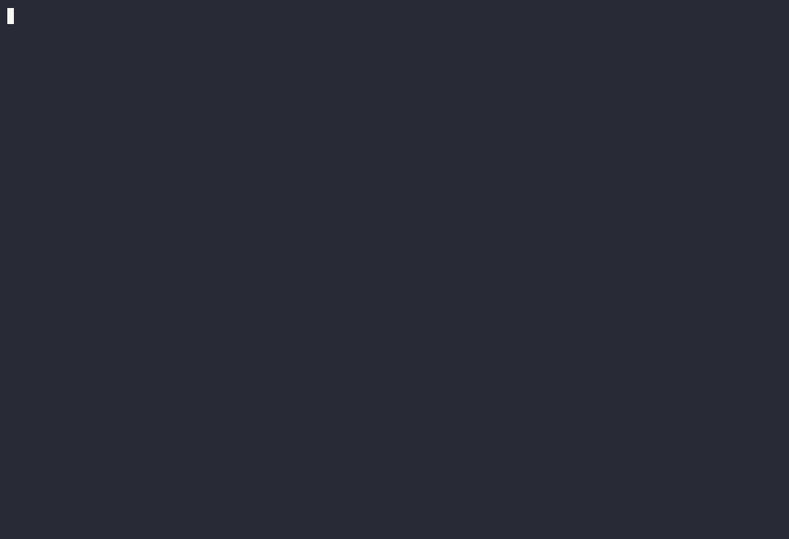
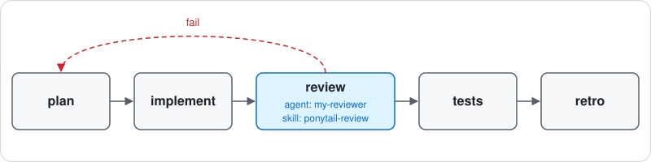

[English](README.md) | [한국어](README.ko.md) | [日本語](README.ja.md) | [简体中文](README.zh-CN.md) | [Español](README.es.md)

<h1 align="center">omge</h1>

<p align="center"><strong>oh-my-graph-engineering</strong>: ejecuta el trabajo de Claude Code como un grafo verificado y deja que cada tarea mejore la siguiente.</p>

<p align="center">
  <a href="LICENSE"></a>
  
  
</p>



**Define tu flujo de trabajo con palabras normales.**

> Hazme un grafo: plan → implement → review → tests. La revisión va antes de escribir los tests, la hace el agente revisor que configuré, y ese agente también debe ejecutar el skill de revisión de ponytail. Si la revisión falla, vuelve a plan, no a implement. De ahora en adelante, aplica este grafo a las tareas relacionadas.

Se convierte en este grafo:

```yaml
params:
  review: '^/[A-Za-z0-9._/-]+\.md$'
nodes:
  - id: plan
    do: Write the plan to PLAN.md.
    check: test -n "$(find PLAN.md -newermt "$WF_READY_SINCE")"
    on_fail: retry
  - id: implement
    after: [plan]
    do: Implement the plan and commit.
    check: test -n "$(git log --since="$WF_READY_SINCE")" && [ -z "$(git status --porcelain)" ]
    on_fail: retry
  - id: review
    after: [implement]
    agent: my-reviewer  # your own reviewer agent (~/.claude/agents/my-reviewer.md)
    skill: ponytail:ponytail-review
    do: >-
      Launch my-reviewer on HEAD and invoke ponytail:ponytail-review. The review goes to a file
      outside the repo ending in `Verdict: pass` and `Reviewed SHA: <sha>`; wf_set review=<absolute path>.
    check: |
      grep -qx 'Verdict: pass' {review} && grep -qx "Reviewed SHA: $(git rev-parse HEAD)" {review}
    on_fail: plan
  - id: tests
    after: [review]
    do: Write the tests and commit.
    check: uv run pytest -q
    on_fail: retry
  - id: retro
    after: [tests]
    do: Call wf_retro() and record a verdict.
```



`agent:` y `skill:` son puertas independientes: review solo se cierra tras lanzar tu agente revisor (my-reviewer) y llamar a ponytail:ponytail-review, y plan e implement solo aceptan trabajo hecho desde que su nodo quedó listo, y review solo una revisión del HEAD actual.

«De ahora en adelante» lo hace el retro: guarda este grafo en tu biblioteca como un tipo nuevo (`new_type`, con una frase `match`), y las peticiones que encajen con esa frase empiezan con él.

**Tú solo haces la ingeniería del grafo.** Diseña los pasos y los checks; omge los hace cumplir; tus agentes y skills de siempre (superpowers, ponytail, los tuyos) hacen el trabajo.

- Un nodo puede exigir cualquier agente (`agent:`) o skill (`skill:`) instalado; omge lo retiene hasta que esa llamada ocurra.
- Sin escribir YAML: dile a `/omge:graph` con palabras normales qué agente y skill debe usar un nodo.
- Más: [Funciona con tus plugins](docs/compatibility.es.md).

omge es solo una herramienta de ingeniería de grafos. Diseña tú mismo los skills y agentes que tu trabajo necesita y conéctalos al grafo.


> Los mensajes en tiempo de ejecución están en inglés (por defecto) o en coreano, según `OMGE_LANG`.

## Por qué

Las tareas largas se desvían: se salta un paso de pruebas, una revisión queda "hecha" sin revisor, la sesión
se detiene a medias. omge convierte una tarea en una lista de nodos, cada uno con un `check` de shell que debe
pasar antes de cerrarse. Los hooks impiden que Claude se salte nodos o se detenga antes de tiempo, y una
retrospectiva (retro) al final devuelve lo aprendido a una biblioteca reutilizable de tipos de workflow.

## Características

- **Nodos verificados**: un nodo con `check` de shell se cierra con `wf_complete` solo cuando el check termina con 0; un nodo `kind: human` sin check se cierra con la evidencia aportada. `on_fail` decide qué pasa después.
- **Hooks que imponen el grafo**: los hooks SessionStart, UserPromptSubmit, Stop, PreToolUse y PostToolUse bloquean pasos saltados y paradas tempranas.
- **Biblioteca guiada por retros**: un nodo `retro` se ejecuta al final de la tarea y puede guardar un grafo mejorado como tipo de la biblioteca, versionado en git; puede omitirse o cerrarse automáticamente cuando no hay nada que mejorar.
- **Agentes por rol**: explorer, implementer, reviewer y planner, cada uno fijado a un alias de modelo que puedes cambiar.
- **Skills incluidas**: `/omge:setup`, `/omge:graph`, `omge:writing-a-plan` y `omge:improving-skills`.
- Mensajes en tiempo de ejecución en **inglés o coreano** (`OMGE_LANG`).

## Inicio rápido

Dentro de Claude Code:

```text
/plugin marketplace add dudals3844/oh-my-graph-engineering
/plugin install omge@oh-my-graph-engineering
/omge:setup
```

Si `/omge:setup` aún no aparece en la lista, ejecuta primero `/reload-plugins`.

O desde tu shell:

```bash
claude plugin marketplace add dudals3844/oh-my-graph-engineering
claude plugin install omge@oh-my-graph-engineering
claude "/omge:setup"
```

`/omge:setup` comprueba que [uv](https://pypi.org/project/uv/) está instalado
(los hooks y el servidor MCP `omge:wf` se ejecutan con él) y ofrece instalar el plugin opcional ponytail.

En el primer uso, uv resuelve las dependencias de Python de omge desde PyPI, fijadas por el `uv.lock`
incluido en el repositorio. Si no hay un Python 3.12 o posterior instalado, uv también descarga uno. No se
descarga nada más, y omge no envía telemetría.
Reanudar una tarea existente (SessionStart) puede volver a ejecutar automáticamente las comprobaciones de los nodos humanos de esa tarea, que pueden leer datos de GitHub (por ejemplo, el estado de fusión de un PR); esto es comprobación del flujo de trabajo, no telemetría.

> [!WARNING]
> **Hooks duplicados:** el plugin registra sus propios hooks SessionStart, UserPromptSubmit, Stop, PreToolUse y
> PostToolUse. Si también configuraste comandos `omge hook ...` en un `settings.json`, elimínalos, o cada hook se
> ejecutará dos veces.
>
> **Si omge no puede arrancar** (falla uv o Python), PreToolUse deja pasar la llamada a la herramienta, porque
> bloquearla denegaría todas las llamadas de toda sesión, con o sin tarea; Stop sigue bloqueando, así que ninguna
> tarea termina con un hook roto.

## Un grafo

```yaml
type: lint-fix
match: fix lint errors and commit
optional_issue: true
nodes:
  - id: fix
    do: Fix every error `ruff check .` reports and commit.
    check: uvx ruff check . && [ -z "$(git status --porcelain)" ]
    on_fail: retry
  - id: review
    after: [fix]
    agent: omge:reviewer
    do: Delegate an independent review of HEAD.
    kind: human
  - id: retro
    after: [review]
    do: Call wf_retro() and record a verdict.
```

Claude inicia una tarea con `wf_start` (un tipo de la biblioteca, o `type="new"` con un grafo puntual), cierra
nodos con `wf_complete` y termina con `wf_retro`. `/omge:graph` explica cada campo de nodo, los params, las
variables de entorno de `check` y cómo un grafo puntual se convierte en un tipo de la biblioteca.

## Plantillas incluidas

| Tipo | Para |
|---|---|
| `code-implementation` | plan → implement → test → review → push/PR, con o sin issue |
| `investigation` | reunir evidencia citada → verificar citas → informar una conclusión |
| `issue-resolution` | un issue de GitHub a través de spec, scope review, plan, implement, test, review, PR, CI, merge, cleanup |

## Agentes

| Agente | Alias de modelo | Rol |
|---|---|---|
| `omge:explorer` | `haiku` | búsqueda de solo lectura con citas `path:line` |
| `omge:implementer` | `sonnet` | hace y confirma (commit) el cambio planificado |
| `omge:reviewer` | `opus` | revisión independiente que termina en `Verdict: pass` / `Reviewed SHA: <sha>` |
| `omge:planner` | `fable` | escribe el plan de implementación |

Para usar otro modelo, copia `agents/<name>.md` en `~/.claude/agents/` o en `.claude/agents/` de un proyecto,
dale un nuevo `name` y otro alias en `model:`, y haz referencia a él en el campo `agent:` de un nodo
(p. ej. `agent: reviewer-sonnet`).

## Skills

| Skill | Uso |
|---|---|
| `/omge:setup` | elige el idioma de los mensajes, comprueba uv, avisa de hooks duplicados, ofrece ponytail |
| `/omge:graph` | referencia para escribir grafos y tipos de la biblioteca |
| `omge:writing-a-plan` | la usan los nodos plan |
| `omge:improving-skills` | corrige tus skills en `~/.claude/skills` a partir de la evidencia de la retro |

## Configuración

| Variable | Efecto |
|---|---|
| `OMGE_LANG` | idioma de los mensajes: `en` (por defecto) o `ko`; sin ella, el locale se lee de `LC_ALL`, `LC_MESSAGES` o `LANG` (p. ej. `ko_KR.UTF-8`); `/omge:setup` la configura |
| `WF_DB` | ruta de la base de datos de tareas (por defecto `~/.local/share/omge/wf.db`) |
| `WF_LIBRARY` | ruta de la biblioteca de tipos, un repositorio git (por defecto `~/.local/share/omge/library/`) |

## Desarrollo

```bash
uv sync --locked --extra dev && uv run pytest -q
```

## Licencia

MIT, ver [LICENSE](LICENSE).
