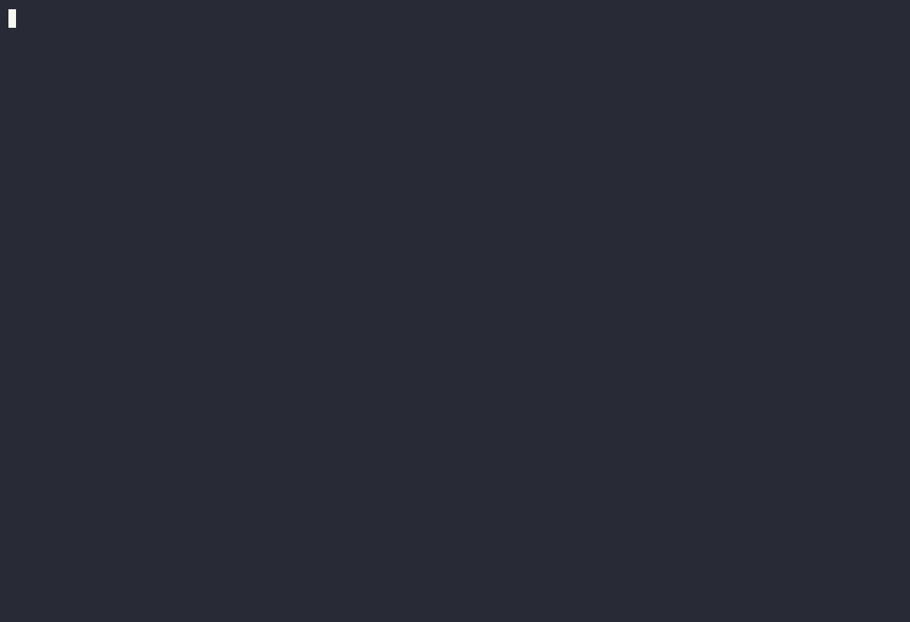
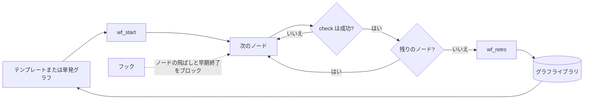

[English](README.md) | [Korean](README.ko.md) | [Japanese](README.ja.md) | [Chinese](README.zh-CN.md) | [Spanish](README.es.md)

<h1 align="center">omge</h1>

<p align="center"><strong>oh-my-graph-engineering</strong>: Claude Code の作業を検証付きのグラフとして実行し、毎回のタスクで次のタスクを改善します。</p>

<p align="center">
  <a href="LICENSE"></a>
  
  
</p>



**ワークフローは普通の言葉で定義できます。**

> グラフを作って: plan → implement → review → tests。テストを書く前に review を行い、review は omge:reviewer エージェントが担当し、そのエージェントは ponytail の review スキルも実行すること。review が失敗したら implement ではなく plan に戻る。今後、関連するタスクにはこのグラフを適用して。

すると次のグラフになります。

```yaml
params:
  review: '^/[A-Za-z0-9._/-]+\.md$'
nodes:
  - id: plan
    do: Write the plan to PLAN.md.
    check: test -n "$(find PLAN.md -newermt "$WF_READY_SINCE")"
    on_fail: retry
  - id: implement
    after: [plan]
    do: Implement the plan and commit.
    check: test -n "$(git log --since="$WF_READY_SINCE")" && [ -z "$(git status --porcelain)" ]
    on_fail: retry
  - id: review
    after: [implement]
    agent: omge:reviewer
    skill: ponytail:ponytail-review
    do: >-
      Launch omge:reviewer on HEAD and invoke ponytail:ponytail-review. The review goes to a file
      outside the repo ending in `Verdict: pass` and `Reviewed SHA: <sha>`; wf_set review=<absolute path>.
    check: |
      grep -qx 'Verdict: pass' {review} && grep -qx "Reviewed SHA: $(git rev-parse HEAD)" {review}
    on_fail: plan
  - id: tests
    after: [review]
    do: Write the tests and commit.
    check: uv run pytest -q
    on_fail: retry
  - id: retro
    after: [tests]
    do: Call wf_retro() and record a verdict.
```

`agent:` と `skill:` は別々のゲートです。review は omge:reviewer の起動と ponytail:ponytail-review の呼び出しの両方があって初めて閉じ、plan と implement はノードが ready になってからの作業だけを、review は現在の HEAD のレビューだけを受け付けます。

「今後」は retro が担います。retro がこのグラフをライブラリに新しいタイプ（`new_type`、`match` の一文付き）として保存し、以後その一文に合う依頼はこのグラフから始まります。

**あなたはグラフエンジニアリングだけに集中できます。** ステップとチェックを設計すれば omge がそれを強制し、作業はすでに持っているエージェントとスキル（superpowers、ponytail、自作のもの）が行います。

- ノードはインストール済みの任意のエージェント（`agent:`）やスキル（`skill:`）を要求でき、omge はその呼び出しが行われるまでノードを止めます。
- YAML は不要です。ノードで使うエージェントとスキルを `/omge:graph` に普通の言葉で伝えてください。
- 詳しくは [手持ちのプラグインと連携](docs/compatibility.ja.md)。

omge はグラフエンジニアリングのツールにすぎません。必要なスキルとエージェントは作業に合わせて自分で設計し、グラフに組み込んでください。


> 実行時のメッセージは英語（デフォルト）または韓国語です。`OMGE_LANG` で切り替えます。

## なぜ必要か

長いタスクは崩れがちです。テストの手順が抜け、レビュアー不在のままレビューが「完了」になり、セッションが途中で止まります。
omge はタスクをノードの列に変換し、各ノードにはクローズ前に成功しなければならないシェルの `check` があります。
フックは Claude がノードを飛ばしたり早く止まったりするのを防ぎ、最後のレトロ（retro）で得た知見を
再利用可能なワークフロータイプのライブラリへ戻します。

## 仕組み



## 機能

- **検証付きノード**: シェルの `check` を持つノードは、その check が 0 で終了したときだけ `wf_complete` で閉じられます。check のない `kind: human` ノードは提出された証拠で閉じます。失敗時の動作は `on_fail` で決まります。
- **グラフを強制するフック**: SessionStart、UserPromptSubmit、Stop、PreToolUse、PostToolUse の各フックが手順の飛ばしと早期終了を防ぎます。
- **レトロ駆動のライブラリ**: タスクの最後に `retro` ノードが実行され、改善したグラフを git でバージョン管理されるライブラリタイプとして保存できます。改善点がなければスキップまたは自動で閉じられることがあります。
- **役割別エージェント**: explorer、implementer、reviewer、planner。それぞれ差し替え可能なモデルエイリアスに固定されています。
- **同梱スキル**: `/omge:setup`、`/omge:graph`、`omge:writing-a-plan`、`omge:improving-skills`。
- **英語または韓国語** の実行時メッセージ（`OMGE_LANG`）。

## クイックスタート

```bash
claude plugin marketplace add dudals3844/oh-my-graph-engineering
claude plugin install omge@oh-my-graph-engineering
```

次に Claude Code で `/omge:setup` を実行します。[uv](https://pypi.org/project/uv/) がインストールされているかを確認し
（フックと `omge:wf` MCP サーバーは uv 経由で動きます）、オプションの ponytail プラグインのインストールを提案します。

初回の使用時に、uv がコミット済みの `uv.lock` に固定された omge の Python 依存関係を PyPI から取得します。
Python 3.12 以降がインストールされていない場合は、uv がそれもダウンロードします。
それ以外は何もダウンロードせず、omge はテレメトリを送信しません。
既存のタスクを再開すると（SessionStart）、そのタスクの人間ノードのチェックが自動的に再実行されることがあり、そのチェックは GitHub から情報を読み取る場合があります（例: PR のマージ状態）。これはテレメトリではなく、ワークフローのチェックです。

> [!WARNING]
> **フックの重複:** このプラグインは独自の SessionStart、UserPromptSubmit、Stop、PreToolUse、PostToolUse フックを登録します。
> `settings.json` にも `omge hook ...` コマンドを設定している場合は削除してください。そうしないとすべてのフックが二重に実行されます。

## グラフの例

```yaml
type: lint-fix
match: fix lint errors and commit
optional_issue: true
nodes:
  - id: fix
    do: Fix every error `ruff check .` reports and commit.
    check: uvx ruff check . && [ -z "$(git status --porcelain)" ]
    on_fail: retry
  - id: review
    after: [fix]
    agent: omge:reviewer
    do: Delegate an independent review of HEAD.
    kind: human
  - id: retro
    after: [review]
    do: Call wf_retro() and record a verdict.
```

Claude は `wf_start` でタスクを開始し（ライブラリタイプ、または単発グラフと `type="new"`）、`wf_complete` でノードを閉じ、
`wf_retro` で終了します。`/omge:graph` はすべてのノードフィールド、params、check の環境変数、
そして単発グラフがライブラリタイプになるまでを説明します。

## 同梱テンプレート

| タイプ | 用途 |
|---|---|
| `code-implementation` | plan → implement → test → review → push/PR（issue の有無を問わない） |
| `investigation` | 出典付きの根拠を収集 → 引用を検証 → 結論を報告 |
| `issue-resolution` | GitHub の issue を spec、scope review、plan、implement、test、review、PR、CI、merge、cleanup まで |

## エージェント

| エージェント | モデルエイリアス | 役割 |
|---|---|---|
| `omge:explorer` | `haiku` | `path:line` の引用付きの読み取り専用検索 |
| `omge:implementer` | `sonnet` | 計画された変更を実装してコミット |
| `omge:reviewer` | `opus` | `Verdict: pass` / `Reviewed SHA: <sha>` で終わる独立レビュー |
| `omge:planner` | `fable` | 実装計画を作成 |

別のモデルを使うには、`agents/<name>.md` を `~/.claude/agents/` またはプロジェクトの `.claude/agents/` にコピーし、
新しい `name` と別の `model:` エイリアスを付けて、ノードの `agent:` フィールドから参照します（例: `agent: reviewer-sonnet`）。

## スキル

| スキル | 用途 |
|---|---|
| `/omge:setup` | uv の確認、フック重複の警告、ponytail の提案 |
| `/omge:graph` | グラフとライブラリタイプを書くためのリファレンス |
| `omge:writing-a-plan` | plan ノードで使用 |
| `omge:improving-skills` | レトロの根拠から `~/.claude/skills` のスキルを修正 |

## 設定

| 変数 | 効果 |
|---|---|
| `OMGE_LANG` | メッセージの言語: `en`（デフォルト）または `ko`。未設定時は `LC_ALL`、`LC_MESSAGES`、`LANG` からロケールを読みます（例: `ko_KR.UTF-8`） |
| `WF_DB` | タスクデータベースのパス（デフォルト `~/.local/share/omge/wf.db`） |
| `WF_LIBRARY` | git リポジトリであるタイプライブラリのパス（デフォルト `~/.local/share/omge/library/`） |

## 開発

```bash
uv sync --locked --extra dev && uv run pytest -q
```

## ライセンス

MIT。[LICENSE](LICENSE) を参照してください。
