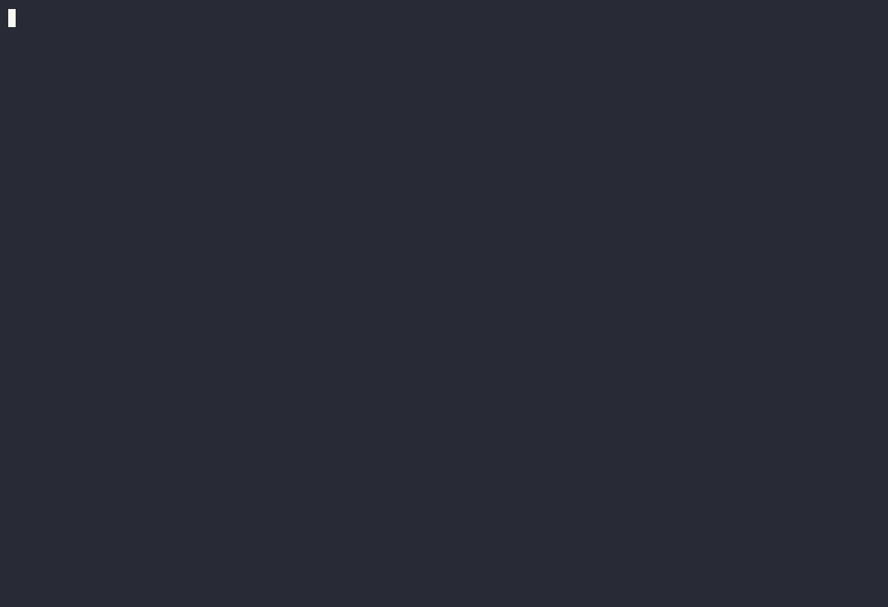
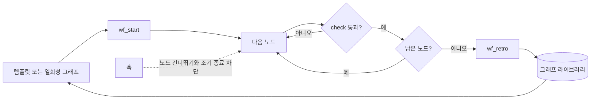

[English](README.md) | [Korean](README.ko.md) | [Japanese](README.ja.md) | [Chinese](README.zh-CN.md) | [Spanish](README.es.md)

<h1 align="center">omge</h1>

<p align="center"><strong>oh-my-graph-engineering</strong>: Claude Code 작업을 검증되는 그래프로 실행하고, 매 작업이 다음 작업을 개선하게 합니다.</p>

<p align="center">
  <a href="LICENSE"></a>
  
  
</p>



**사용자는 그래프 엔지니어링만 하면 됩니다.** 단계와 검증을 설계하면 omge가 그것을 강제하고, 일은 이미 가진 에이전트와 스킬(superpowers, ponytail, 직접 만든 것)이 합니다.

- 노드는 설치된 어떤 에이전트(`agent:`)나 스킬(`skill:`)이든 요구할 수 있고, omge는 그 호출이 일어날 때까지 노드를 막습니다.
- YAML을 쓸 필요가 없습니다. `/omge:graph`에 노드가 쓸 에이전트와 스킬을 평범한 말로 알려 주세요.
- 자세히: [설치한 플러그인과 함께 동작](docs/compatibility.ko.md).

> 런타임 메시지는 영어(기본) 또는 한국어로 출력됩니다. 한국어로 보려면 `OMGE_LANG=ko`를 설정하세요.

## 왜 필요한가

긴 작업은 흐트러집니다. 테스트 단계가 빠지고, 리뷰어 없이 리뷰가 "완료"되고, 세션이 중간에 멈춥니다.
omge는 작업을 노드 목록으로 바꾸고, 각 노드에는 닫히기 전에 통과해야 하는 셸 `check`가 있습니다.
훅은 Claude가 노드를 건너뛰거나 일찍 멈추지 못하게 막고, 마지막 회고(retro)는 배운 것을 재사용
가능한 워크플로 타입 라이브러리에 되돌려 줍니다.

## 동작 방식



## 기능

- **검증되는 노드**: 셸 `check`가 있는 노드는 그 check가 0으로 끝나야만 `wf_complete`로 닫히고, check가 없는 `kind: human` 노드는 제출한 근거로 닫힙니다. 실패 시 동작은 `on_fail`이 정합니다.
- **그래프를 강제하는 훅**: SessionStart, UserPromptSubmit, Stop, PreToolUse, PostToolUse 훅이 단계 건너뛰기와 조기 종료를 막습니다.
- **회고 기반 라이브러리**: 작업 끝에 `retro` 노드가 실행되어 개선된 그래프를 git으로 버전 관리되는 라이브러리 타입으로 저장할 수 있으며, 개선할 것이 없으면 건너뛰거나 자동으로 닫힐 수 있습니다.
- **역할 에이전트**: explorer, implementer, reviewer, planner. 각각 바꿀 수 있는 모델 별칭에 고정됩니다.
- **번들 스킬**: `/omge:setup`, `/omge:graph`, `omge:writing-a-plan`, `omge:improving-skills`.
- **영어 또는 한국어** 런타임 메시지 (`OMGE_LANG`).

## 빠른 시작

```bash
claude plugin marketplace add dudals3844/oh-my-graph-engineering
claude plugin install omge@oh-my-graph-engineering
```

그다음 Claude Code에서 `/omge:setup`을 실행하세요. [uv](https://pypi.org/project/uv/) 설치 여부를 확인하고
(훅과 `omge:wf` MCP 서버가 uv로 실행됩니다), 선택 사항인 ponytail 플러그인 설치를 제안합니다.

처음 사용할 때 uv가 커밋된 `uv.lock`에 고정된 omge의 Python 의존성을 PyPI에서 받아옵니다.
Python 3.12 이상이 설치되어 있지 않으면 uv가 그것도 내려받습니다.
그 밖에는 아무것도 내려받지 않으며, omge는 텔레메트리를 보내지 않습니다.
기존 작업을 재개하면(SessionStart) 그 작업의 사람 노드 검사가 자동으로 다시 실행될 수 있으며, 이 검사는 GitHub에서 정보를 읽을 수 있습니다(예: PR의 병합 상태). 이는 텔레메트리가 아니라 워크플로 검사입니다.

> [!WARNING]
> **중복 훅:** 플러그인은 자체 SessionStart, UserPromptSubmit, Stop, PreToolUse, PostToolUse 훅을 등록합니다.
> `settings.json`에 `omge hook ...` 명령도 연결해 두었다면 제거하세요. 그렇지 않으면 모든 훅이 두 번 실행됩니다.

## 그래프 예시

```yaml
type: lint-fix
match: fix lint errors and commit
optional_issue: true
nodes:
  - id: fix
    do: Fix every error `ruff check .` reports and commit.
    check: uvx ruff check . && [ -z "$(git status --porcelain)" ]
    on_fail: retry
  - id: review
    after: [fix]
    agent: omge:reviewer
    do: Delegate an independent review of HEAD.
    kind: human
  - id: retro
    after: [review]
    do: Call wf_retro() and record a verdict.
```

Claude는 `wf_start`로 작업을 시작하고(라이브러리 타입, 또는 일회성 그래프와 함께 `type="new"`),
`wf_complete`로 노드를 닫고, `wf_retro`로 마칩니다. `/omge:graph`는 모든 노드 필드, params, check 환경 변수,
그리고 일회성 그래프가 라이브러리 타입이 되는 과정을 설명합니다.

## 기본 제공 템플릿

| 타입 | 용도 |
|---|---|
| `code-implementation` | plan → implement → test → review → push/PR, 이슈 유무와 관계없이 |
| `investigation` | 출처가 있는 근거 수집 → 인용 검증 → 결론 보고 |
| `issue-resolution` | GitHub 이슈를 spec, scope review, plan, implement, test, review, PR, CI, merge, cleanup까지 |

## 에이전트

| 에이전트 | 모델 별칭 | 역할 |
|---|---|---|
| `omge:explorer` | `haiku` | `path:line` 인용을 남기는 읽기 전용 검색 |
| `omge:implementer` | `sonnet` | 계획된 변경을 만들고 커밋 |
| `omge:reviewer` | `opus` | `Verdict: pass` / `Reviewed SHA: <sha>`로 끝나는 독립 리뷰 |
| `omge:planner` | `fable` | 구현 계획 작성 |

다른 모델을 쓰려면 `agents/<name>.md`를 `~/.claude/agents/` 또는 프로젝트의 `.claude/agents/`로 복사하고,
새 `name`과 다른 `model:` 별칭을 지정한 뒤 노드의 `agent:` 필드에서 참조하세요(예: `agent: reviewer-sonnet`).

## 스킬

| 스킬 | 용도 |
|---|---|
| `/omge:setup` | uv 확인, 중복 훅 경고, ponytail 제안 |
| `/omge:graph` | 그래프와 라이브러리 타입 작성 레퍼런스 |
| `omge:writing-a-plan` | plan 노드에서 사용 |
| `omge:improving-skills` | 회고 근거로 `~/.claude/skills`의 스킬을 수정 |

## 설정

| 변수 | 효과 |
|---|---|
| `OMGE_LANG` | 메시지 언어: `en`(기본) 또는 `ko`. 없으면 `LC_ALL`, `LC_MESSAGES`, `LANG`에서 로케일을 읽습니다(예: `ko_KR.UTF-8`) |
| `WF_DB` | 작업 데이터베이스 경로 (기본 `~/.local/share/omge/wf.db`) |
| `WF_LIBRARY` | git 저장소인 타입 라이브러리 경로 (기본 `~/.local/share/omge/library/`) |

## 개발

```bash
uv sync --locked --extra dev && uv run pytest -q
```

## 라이선스

MIT, [LICENSE](LICENSE) 참고.
