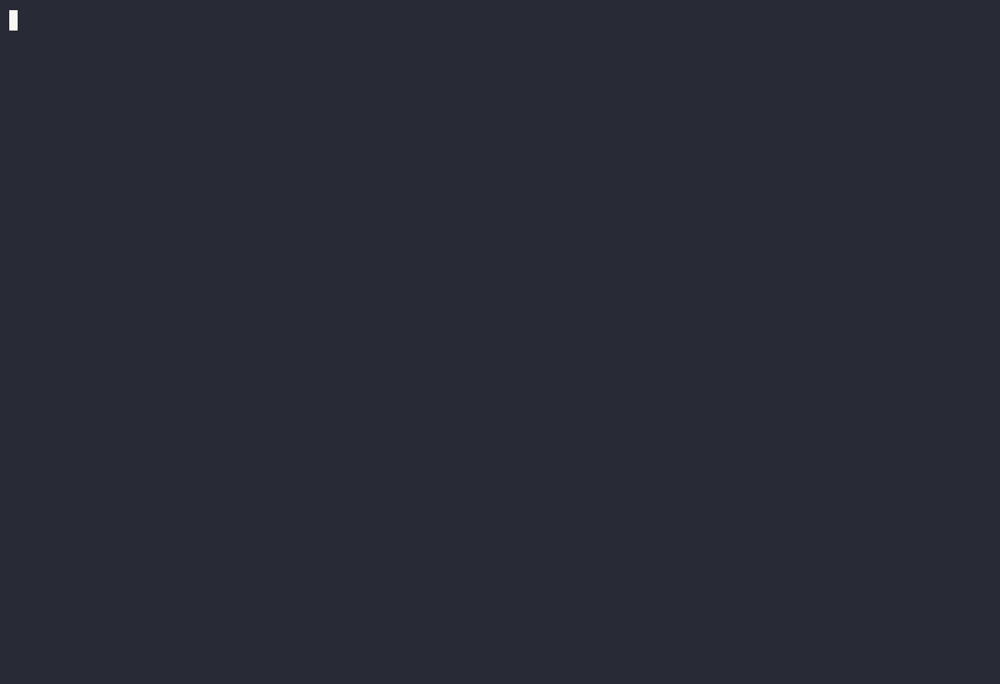
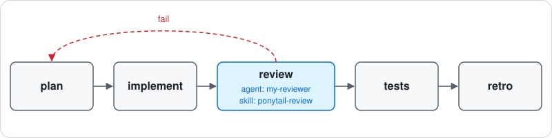

[English](README.md) | [한국어](README.ko.md) | [日本語](README.ja.md) | [简体中文](README.zh-CN.md) | [Español](README.es.md)

<h1 align="center">omge</h1>

<p align="center"><strong>oh-my-graph-engineering</strong>: run Claude Code work as a checked graph, and let every task improve the next one.</p>

<p align="center">
  <a href="LICENSE"></a>
  
  
</p>



**Define your workflow in plain words.**

> Make me a graph: plan → implement → review → tests. Review must happen before writing tests, done by the reviewer agent I set up, and that agent must also run the ponytail review skill. If the review fails, go back to plan, not implement. From now on, apply this graph to related tasks.

It becomes this graph:

```yaml
params:
  review: '^/[A-Za-z0-9._/-]+\.md$'
nodes:
  - id: plan
    do: Write the plan to PLAN.md.
    check: test -n "$(find PLAN.md -newermt "$WF_READY_SINCE")"
    on_fail: retry
  - id: implement
    after: [plan]
    do: Implement the plan and commit.
    check: test -n "$(git log --since="$WF_READY_SINCE")" && [ -z "$(git status --porcelain)" ]
    on_fail: retry
  - id: review
    after: [implement]
    agent: my-reviewer  # your own reviewer agent (~/.claude/agents/my-reviewer.md)
    skill: ponytail:ponytail-review
    do: >-
      Launch my-reviewer on HEAD and invoke ponytail:ponytail-review. The review goes to a file
      outside the repo ending in `Verdict: pass` and `Reviewed SHA: <sha>`; wf_set review=<absolute path>.
    check: |
      grep -qx 'Verdict: pass' {review} && grep -qx "Reviewed SHA: $(git rev-parse HEAD)" {review}
    on_fail: plan
  - id: tests
    after: [review]
    do: Write the tests and commit.
    check: uv run pytest -q
    on_fail: retry
  - id: retro
    after: [tests]
    do: Call wf_retro() and record a verdict.
```



`agent:` and `skill:` are separate gates: review closes only after a launch of your reviewer agent (my-reviewer) and a ponytail:ponytail-review call, and plan and implement accept only work done since their node became ready, review only a review of the current HEAD.

"From now on" is the retro: it saves this graph to your library as a new type (`new_type`, with a `match` sentence), and later requests that match it start with this graph.

A longer process works the same way:

> Make me a graph: investigate → plan → implement, then unit tests and an independent review in parallel. A test failure goes back to implement, a review failure back to plan. After both pass, run the integration tests, then wait for my explicit release approval before the retro.

It becomes this graph:

```yaml
params:
  review: '^/[A-Za-z0-9._/-]+\.md$'
nodes:
  - id: investigate
    agent: my-researcher  # your own research agent that can write files (~/.claude/agents/my-researcher.md)
    do: Launch my-researcher to map the affected code; write cited findings to FINDINGS.md.
    check: test -n "$(find FINDINGS.md -newermt "$WF_READY_SINCE")"
    on_fail: retry
  - id: plan
    after: [investigate]
    do: Write the plan to PLAN.md from FINDINGS.md.
    check: test -n "$(find PLAN.md -newermt "$WF_READY_SINCE")"
    on_fail: retry
  - id: implement
    after: [plan]
    do: Implement the plan and commit.
    check: test -n "$(git log --since="$WF_READY_SINCE")" && [ -z "$(git status --porcelain)" ]
    on_fail: retry
  - id: unit_tests
    after: [implement]
    do: Run the unit tests.
    check: uv run pytest -q tests/unit
    on_fail: implement
  - id: review
    after: [implement]
    agent: my-reviewer
    do: >-
      Launch my-reviewer on HEAD. The review goes to a file outside the repo ending in
      `Verdict: pass` and `Reviewed SHA: <sha>`; wf_set review=<absolute path>.
    check: |
      grep -qx 'Verdict: pass' {review} && grep -qx "Reviewed SHA: $(git rev-parse HEAD)" {review}
    on_fail: plan
  - id: integration
    after: [unit_tests, review]
    do: Run the integration tests.
    check: uv run pytest -q tests/integration
    on_fail: implement
  - id: release
    after: [integration]
    kind: human
    do: Ask me to approve the release and record my reply as the evidence.
  - id: retro
    after: [release]
    do: Call wf_retro() and record a verdict.
```

`unit_tests` and `review` both wait only on `implement`, so they are ready together; `integration` waits for both. `release` is a `kind: human` node with no check: it closes on the evidence recorded, here your approval.

**You only do the graph engineering.** Design the steps and the checks; omge enforces them; your existing agents and skills (superpowers, ponytail, your own) do the work.

- A node can require any installed agent (`agent:`) or skill (`skill:`); omge holds it until that call happens.
- No YAML needed: tell `/omge:graph` in plain words which agent and skill a node should use.
- More: [Works with your plugins](docs/compatibility.md).

omge is just a graph engineering tool. Design the skills and agents your work needs yourself and plug them into the graph.


## Why

Long tasks drift: a test step gets skipped, a review is "done" without a reviewer, the session stops
halfway. omge turns a task into a list of nodes, each with a shell `check` that must pass before it
closes. Hooks keep Claude from skipping nodes or stopping early, and a retro at the end feeds what was
learned back into a reusable library of workflow types.

## Features

- **Checked nodes**: a node with a shell `check` closes with `wf_complete` only when the check exits 0; a `kind: human` node without one closes on the evidence given. `on_fail` decides what happens next.
- **Hooks that enforce the graph**: SessionStart, UserPromptSubmit, Stop, PreToolUse and PostToolUse hooks block skipped steps and early stops.
- **Retro-driven library**: a `retro` node runs at the end of a task and can save an improved graph as a library type, versioned in git; it may be skipped or auto-closed when there is nothing to improve.
- **Role agents**: explorer, implementer, reviewer and planner, each pinned to a model alias you can swap.
- **Bundled skills**: `/omge:setup`, `/omge:graph`, `omge:writing-a-plan` and `omge:improving-skills`.
- **English or Korean** runtime messages (`OMGE_LANG`).

## Quick Start

Inside Claude Code:

```text
/plugin marketplace add dudals3844/oh-my-graph-engineering
/plugin install omge@oh-my-graph-engineering
/omge:setup
```

If `/omge:setup` is not listed yet, run `/reload-plugins` first.

Or from your shell:

```bash
claude plugin marketplace add dudals3844/oh-my-graph-engineering
claude plugin install omge@oh-my-graph-engineering
claude "/omge:setup"
```

`/omge:setup` checks that [uv](https://pypi.org/project/uv/) is installed (the
hooks and the `omge:wf` MCP server run through it) and offers to install the optional ponytail plugin.

On first use, uv resolves omge's Python dependencies from PyPI, pinned by the committed `uv.lock`.
If no Python 3.12 or newer is installed, uv also downloads one. Nothing else is downloaded, and omge
sends no telemetry.
Resuming an existing task (SessionStart) can automatically re-run that task's human-node checks, which may read from GitHub (e.g. a PR's merge state); this is workflow checking, not telemetry.

> [!WARNING]
> **Duplicate hooks:** the plugin registers its own SessionStart, UserPromptSubmit, Stop, PreToolUse and
> PostToolUse hooks. If you also wired `omge hook ...` commands into a `settings.json`, remove them, or
> every hook runs twice.
>
> **If omge cannot start** (uv or Python fails), PreToolUse lets the tool call through, since blocking would
> deny every tool call in every session, task or not; Stop still blocks, so no task finishes past a broken hook.

## A graph

```yaml
type: lint-fix
match: fix lint errors and commit
optional_issue: true
nodes:
  - id: fix
    do: Fix every error `ruff check .` reports and commit.
    check: uvx ruff check . && [ -z "$(git status --porcelain)" ]
    on_fail: retry
  - id: review
    after: [fix]
    agent: omge:reviewer
    do: Delegate an independent review of HEAD.
    kind: human
  - id: retro
    after: [review]
    do: Call wf_retro() and record a verdict.
```

Claude starts a task with `wf_start` (a library type, or `type="new"` with a one-off graph), closes nodes
with `wf_complete`, and finishes with `wf_retro`. `/omge:graph` explains every node field, params, check
environment variables, and how a one-off graph becomes a library type.

## Shipped templates

| Type | For |
|---|---|
| `code-implementation` | plan → implement → test → review → push/PR, with or without an issue |
| `investigation` | collect cited evidence → verify citations → report a conclusion |
| `issue-resolution` | a GitHub issue through spec, scope review, plan, implement, test, review, PR, CI, merge, cleanup |

## Agents

| Agent | Model alias | Role |
|---|---|---|
| `omge:explorer` | `haiku` | read-only search with `path:line` citations |
| `omge:implementer` | `sonnet` | makes and commits the planned change |
| `omge:reviewer` | `opus` | independent review ending in `Verdict: pass` / `Reviewed SHA: <sha>` |
| `omge:planner` | `fable` | writes the implementation plan |

To use another model, copy `agents/<name>.md` into `~/.claude/agents/` or a project's `.claude/agents/`,
give it a new `name` and another `model:` alias, and reference it in a node's `agent:` field
(e.g. `agent: reviewer-sonnet`).

## Skills

| Skill | Use |
|---|---|
| `/omge:setup` | picks the message language, checks uv, warns about duplicate hooks, offers ponytail |
| `/omge:graph` | reference for writing graphs and library types |
| `omge:writing-a-plan` | used by plan nodes |
| `omge:improving-skills` | patches your skills in `~/.claude/skills` from retro evidence |

## Configuration

| Variable | Effect |
|---|---|
| `OMGE_LANG` | message language: `en` (default) or `ko`; without it the locale comes from `LC_ALL`, `LC_MESSAGES` or `LANG` (e.g. `ko_KR.UTF-8`); `/omge:setup` sets it |
| `WF_DB` | path of the task database (default `~/.local/share/omge/wf.db`) |
| `WF_LIBRARY` | path of the type library, a git repository (default `~/.local/share/omge/library/`) |

## Development

```bash
uv sync --locked --extra dev && uv run pytest -q
```

## License

MIT, see [LICENSE](LICENSE).
