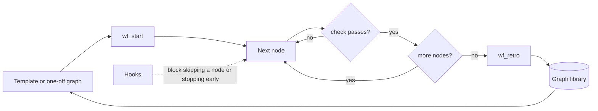

[English](README.md) | [Korean](README.ko.md) | [Japanese](README.ja.md) | [Chinese](README.zh-CN.md) | [Spanish](README.es.md)

<h1 align="center">omge</h1>

<p align="center"><strong>oh-my-graph-engineering</strong>: run Claude Code work as a checked graph, and let every task improve the next one.</p>

<p align="center">
  <a href="LICENSE"></a>
  
  
</p>


## Why

Long tasks drift: a test step gets skipped, a review is "done" without a reviewer, the session stops
halfway. omge turns a task into a list of nodes, each with a shell `check` that must pass before it
closes. Hooks keep Claude from skipping nodes or stopping early, and a retro at the end feeds what was
learned back into a reusable library of workflow types.

## How it works



## Features

- **Checked nodes**: a node with a shell `check` closes with `wf_complete` only when the check exits 0; a `kind: human` node without one closes on the evidence given. `on_fail` decides what happens next.
- **Hooks that enforce the graph**: SessionStart, UserPromptSubmit, Stop, PreToolUse and PostToolUse hooks block skipped steps and early stops.
- **Retro-driven library**: a `retro` node runs at the end of a task and can save an improved graph as a library type, versioned in git; it may be skipped or auto-closed when there is nothing to improve.
- **Role agents**: explorer, implementer, reviewer and planner, each pinned to a model alias you can swap.
- **Bundled skills**: `/omge:setup`, `/omge:graph`, `omge:writing-a-plan` and `omge:improving-skills`.
- **English or Korean** runtime messages (`OMGE_LANG`).

## Quick Start

```bash
claude plugin marketplace add dudals3844/oh-my-graph-engineering
claude plugin install omge@oh-my-graph-engineering
```

Then run `/omge:setup` in Claude Code. It checks that [uv](https://pypi.org/project/uv/) is installed (the
hooks and the `wf` MCP server run through it) and offers to install the optional ponytail plugin.

On first use, uv resolves omge's Python dependencies from PyPI, pinned by the committed `uv.lock`.
If no Python 3.12 or newer is installed, uv also downloads one. Nothing else is downloaded, and omge
sends no telemetry.
Resuming an existing task (SessionStart) can automatically re-run that task's human-node checks, which may read from GitHub (e.g. a PR's merge state); this is workflow checking, not telemetry.

> [!WARNING]
> **Duplicate hooks:** the plugin registers its own SessionStart, UserPromptSubmit, Stop, PreToolUse and
> PostToolUse hooks. If you also wired `wf hook ...` commands into a `settings.json`, remove them, or
> every hook runs twice.

## A graph

```yaml
type: lint-fix
match: fix lint errors and commit
optional_issue: true
nodes:
  - id: fix
    do: Fix every error `ruff check .` reports and commit.
    check: uvx ruff check . && [ -z "$(git status --porcelain)" ]
    on_fail: retry
  - id: review
    after: [fix]
    agent: omge:reviewer
    do: Delegate an independent review of HEAD.
    kind: human
  - id: retro
    after: [review]
    do: Call wf_retro() and record a verdict.
```

Claude starts a task with `wf_start` (a library type, or `type="new"` with a one-off graph), closes nodes
with `wf_complete`, and finishes with `wf_retro`. `/omge:graph` explains every node field, params, check
environment variables, and how a one-off graph becomes a library type.

## Shipped templates

| Type | For |
|---|---|
| `code-implementation` | plan → implement → test → review → push/PR, with or without an issue |
| `investigation` | collect cited evidence → verify citations → report a conclusion |
| `issue-resolution` | a GitHub issue through spec, scope review, plan, implement, test, review, PR, CI, merge, cleanup |

## Agents

| Agent | Model alias | Role |
|---|---|---|
| `omge:explorer` | `haiku` | read-only search with `path:line` citations |
| `omge:implementer` | `sonnet` | makes and commits the planned change |
| `omge:reviewer` | `opus` | independent review ending in `Verdict: pass` / `Reviewed SHA: <sha>` |
| `omge:planner` | `fable` | writes the implementation plan |

To use another model, copy `agents/<name>.md` into `~/.claude/agents/` or a project's `.claude/agents/`,
give it a new `name` and another `model:` alias, and reference it in a node's `agent:` field
(e.g. `agent: reviewer-sonnet`).

## Skills

| Skill | Use |
|---|---|
| `/omge:setup` | checks uv, warns about duplicate hooks, offers ponytail |
| `/omge:graph` | reference for writing graphs and library types |
| `omge:writing-a-plan` | used by plan nodes |
| `omge:improving-skills` | patches your skills in `~/.claude/skills` from retro evidence |

## Configuration

| Variable | Effect |
|---|---|
| `OMGE_LANG` | message language: `en` (default) or `ko`; without it the locale comes from `LC_ALL`, `LC_MESSAGES` or `LANG` (e.g. `ko_KR.UTF-8`) |
| `WF_DB` | path of the task database (default `~/.local/share/omge/wf.db`) |
| `WF_LIBRARY` | path of the type library, a git repository (default `~/.local/share/omge/library/`) |

## Development

```bash
uv sync --locked --extra dev && uv run pytest -q
```

## License

MIT, see [LICENSE](LICENSE).
