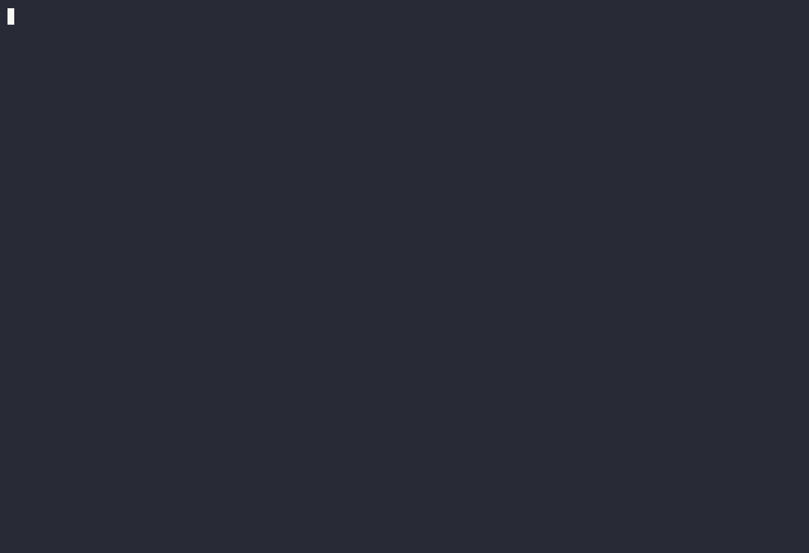
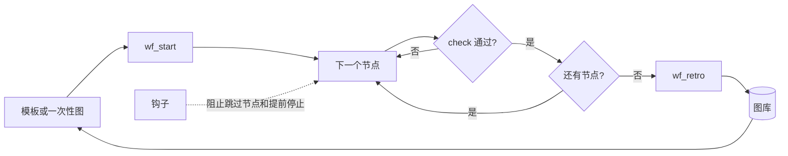

[English](README.md) | [Korean](README.ko.md) | [Japanese](README.ja.md) | [Chinese](README.zh-CN.md) | [Spanish](README.es.md)

<h1 align="center">omge</h1>

<p align="center"><strong>oh-my-graph-engineering</strong>：把 Claude Code 的工作作为带校验的图来运行，让每个任务都改进下一个任务。</p>

<p align="center">
  <a href="LICENSE"></a>
  
  
</p>



> 运行时消息为英文（默认）或韩文，通过 `OMGE_LANG` 切换。

## 为什么

长任务容易走偏：测试步骤被跳过，没有评审者的评审被标记为“完成”，会话半途停下。
omge 把任务变成一组节点，每个节点都有一个必须通过才能关闭的 shell `check`。
钩子阻止 Claude 跳过节点或提前停止，任务结束时的复盘（retro）把经验写回可复用的工作流类型库。

## 工作原理



## 功能

- **带校验的节点**：带 shell `check` 的节点只有在 check 以 0 退出时才能用 `wf_complete` 关闭；没有 check 的 `kind: human` 节点凭提交的证据关闭。失败后的处理由 `on_fail` 决定。
- **强制执行图的钩子**：SessionStart、UserPromptSubmit、Stop、PreToolUse 和 PostToolUse 钩子阻止跳步和提前停止。
- **复盘驱动的库**：任务末尾运行 `retro` 节点，可以把改进后的图保存为库类型，并用 git 进行版本管理；没有可改进之处时可能被跳过或自动关闭。
- **角色代理**：explorer、implementer、reviewer 和 planner，各自绑定一个可替换的模型别名。
- **内置技能**：`/omge:setup`、`/omge:graph`、`omge:writing-a-plan` 和 `omge:improving-skills`。
- **英文或韩文** 运行时消息（`OMGE_LANG`）。

## 快速开始

```bash
claude plugin marketplace add dudals3844/oh-my-graph-engineering
claude plugin install omge@oh-my-graph-engineering
```

然后在 Claude Code 中运行 `/omge:setup`。它会检查是否已安装 [uv](https://pypi.org/project/uv/)
（钩子和 `wf` MCP 服务器都通过 uv 运行），并提供安装可选的 ponytail 插件。

> [!WARNING]
> **重复的钩子：** 插件会注册自己的 SessionStart、UserPromptSubmit、Stop、PreToolUse 和 PostToolUse 钩子。
> 如果你还在 `settings.json` 中配置了 `wf hook ...` 命令，请删除它们，否则每个钩子都会运行两次。

## 图示例

```yaml
type: lint-fix
match: fix lint errors and commit
optional_issue: true
nodes:
  - id: fix
    do: Fix every error `ruff check .` reports and commit.
    check: uvx ruff check . && [ -z "$(git status --porcelain)" ]
    on_fail: retry
  - id: review
    after: [fix]
    agent: omge:reviewer
    do: Delegate an independent review of HEAD.
    kind: human
  - id: retro
    after: [review]
    do: Call wf_retro() and record a verdict.
```

Claude 用 `wf_start` 开始任务（库类型，或带一次性图的 `type="new"`），用 `wf_complete` 关闭节点，
最后用 `wf_retro` 结束。`/omge:graph` 说明了所有节点字段、params、check 环境变量，
以及一次性图如何成为库类型。

## 内置模板

| 类型 | 用途 |
|---|---|
| `code-implementation` | plan → implement → test → review → push/PR，有无 issue 均可 |
| `investigation` | 收集带出处的证据 → 核实引用 → 报告结论 |
| `issue-resolution` | 一个 GitHub issue 走完 spec、scope review、plan、implement、test、review、PR、CI、merge、cleanup |

## 代理

| 代理 | 模型别名 | 角色 |
|---|---|---|
| `omge:explorer` | `haiku` | 带 `path:line` 引用的只读搜索 |
| `omge:implementer` | `sonnet` | 实现并提交计划中的变更 |
| `omge:reviewer` | `opus` | 以 `Verdict: pass` / `Reviewed SHA: <sha>` 结尾的独立评审 |
| `omge:planner` | `fable` | 编写实现计划 |

要换用其他模型，把 `agents/<name>.md` 复制到 `~/.claude/agents/` 或项目的 `.claude/agents/`，
设置新的 `name` 和另一个 `model:` 别名，然后在节点的 `agent:` 字段中引用它（例如 `agent: reviewer-sonnet`）。

## 技能

| 技能 | 用途 |
|---|---|
| `/omge:setup` | 检查 uv，提示重复钩子，提供 ponytail |
| `/omge:graph` | 编写图和库类型的参考 |
| `omge:writing-a-plan` | 供 plan 节点使用 |
| `omge:improving-skills` | 根据复盘证据修改 `~/.claude/skills` 中的技能 |

## 配置

| 变量 | 作用 |
|---|---|
| `OMGE_LANG` | 消息语言：`en`（默认）或 `ko`；未设置时从 `LC_ALL`、`LC_MESSAGES` 或 `LANG` 读取区域设置（例如 `ko_KR.UTF-8`） |
| `WF_DB` | 任务数据库路径（默认 `~/.local/share/omge/wf.db`） |
| `WF_LIBRARY` | 类型库路径，是一个 git 仓库（默认 `~/.local/share/omge/library/`） |

## 开发

```bash
uv sync --locked --extra dev && uv run pytest -q
```

## 许可证

MIT，见 [LICENSE](LICENSE)。
